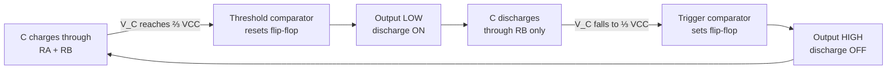
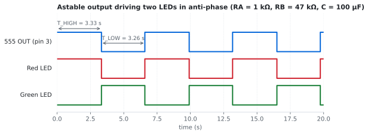
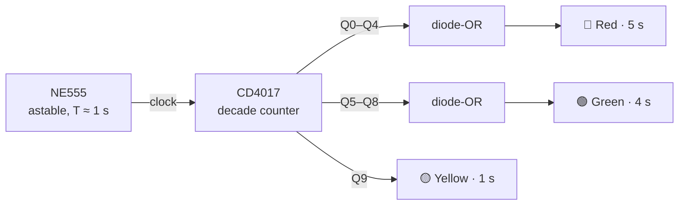
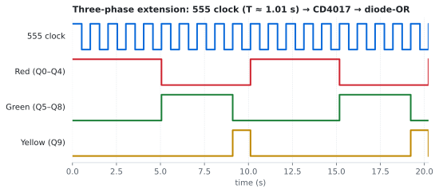

# 🚦 NE555-Based Traffic Light Timing Circuit

> Traffic-light timing built entirely in hardware, with no microcontroller and no code. The timing comes from a resistor-capacitor network and the NE555's internal comparators.


---

## Contents
1. [Project Overview](#1-project-overview) · 2. [Objective](#2-objective) · 3. [Components](#3-components) · 4. [Working Principle](#4-working-principle) · 5. [Circuit Design](#5-circuit-design) · 6. [Implementation](#6-implementation) · 7. [Source Code](#7-source-code) · 8. [Results](#8-results) · 9. [Challenges](#9-challenges) · 10. [Future Improvements](#10-future-improvements)

---

## 1. Project Overview

Before reaching for an Arduino, it's worth asking whether the problem needs one at all. A traffic light is basically a **timing** problem, and timing is what the NE555 was built for.

This project uses the 555 in **astable mode** to make a continuous square wave, with the period set only by two resistors and a capacitor. That square wave drives the LED indicators.

## 2. Objective

- Generate repeatable timed intervals using only passive components and a timer IC.
- Understand, and actually *calculate*, the link between R, C and time.
- Find the limits of a single 555 and work out what's needed for a full three-phase sequence.

## 3. Components

| Component | Role | Why |
|---|---|---|
| NE555N | Timer / oscillator | Confirmed original component. Wide supply range (4.5–16 V) and an output that can drive LEDs directly. |
| Red, Yellow, Green LEDs | Indicators | |
| R<sub>A</sub>, R<sub>B</sub> | Timing resistors | Set the charge and discharge times |
| C | Timing capacitor | Electrolytic, for second-scale periods |
| 10 nF capacitor | Pin 5 (CONT) decoupling | Keeps noise off the internal ⅔ V<sub>CC</sub> reference |
| 220 Ω resistors | LED current limiting | (5 V − 2 V) / 220 Ω ≈ 14 mA |
| Breadboard, DC supply (5 V) | | |

Bill of materials: [`BOM.md`](BOM.md)

## 4. Working Principle

Inside the 555 are two comparators, an SR flip-flop and a discharge transistor. A resistor divider sets two reference levels: **⅓ V<sub>CC</sub>** and **⅔ V<sub>CC</sub>**.



Because the capacitor only ever swings between ⅓ and ⅔ of V<sub>CC</sub>, the **supply voltage cancels out** of the timing equations. That's why the 555 keeps accurate time even on a sagging battery.

$$T_{HIGH} = \ln 2\,(R_A + R_B)\,C \approx 0.693\,(R_A + R_B)\,C$$

$$T_{LOW} = 0.693\,R_B\,C$$

$$f = \frac{1}{0.693\,(R_A + 2R_B)\,C}, \qquad D = \frac{R_A + R_B}{R_A + 2R_B}$$

**Design consequence:** in the standard astable circuit, T<sub>HIGH</sub> is always longer than T<sub>LOW</sub>, so the duty cycle is always above 50 %. To get near-equal ON/OFF times, make **R<sub>A</sub> ≪ R<sub>B</sub>**. But R<sub>A</sub> can't be zero: it's the only thing limiting current into the discharge pin, so I kept it at 1 kΩ.

Full calculations are in [`Calculations/`](Calculations/).

## 5. Circuit Design

### Configuration A: two-phase (single 555)

One 555 output has two states, so it can directly drive **two** lights in anti-phase:

- **Red** LED from OUT (pin 3) to GND: lit when the output is HIGH (the 555 **sources** current).
- **Green** LED from V<sub>CC</sub> to OUT: lit when the output is LOW (the 555 **sinks** current).

A bipolar NE555's HIGH output sits about 1.7 V below V<sub>CC</sub>. That leaves the green LED with less than its ~2 V forward voltage, so it stays fully off while the red one is lit.

| 555 pin | Connects to |
|---|---|
| 1 GND | GND |
| 2 TRIG | joined to pin 6, top of C |
| 3 OUT | → 220 Ω → Red LED → GND  ·  V<sub>CC</sub> → 220 Ω → Green LED → pin 3 |
| 4 RESET | V<sub>CC</sub> (never reset) |
| 5 CONT | 10 nF → GND |
| 6 THR | joined to pin 2, top of C |
| 7 DISCH | junction of R<sub>A</sub> and R<sub>B</sub> |
| 8 VCC | +5 V |

```
 +5V ──[RA 1kΩ]──┬──[RB 47kΩ]──┬── pins 2 & 6
                 │             │
              pin 7          ══╪══ C 100µF
                               │
                              GND
```

<p align="center"></p>

### Configuration B: full three-phase sequence

A real traffic light needs **three** states with *different* lengths (long red, long green, short yellow). One square wave can't do that. The standard fix is to use the 555 only as a **clock** and let a **CD4017 decade counter** do the sequencing:



Each light's duration is set by **how many counter outputs feed it**, not by changing R or C. 1N4148 diodes OR several outputs together without the outputs shorting into each other. The CD4017's outputs can only supply a few milliamps, so for bright LEDs each light gets a small NPN transistor buffer (or a 1 kΩ series resistor for a dimmer, direct drive).

<p align="center"></p>

## 6. Implementation

1. Place the 555, connect V<sub>CC</sub> (pin 8), GND (pin 1), and tie RESET (pin 4) to V<sub>CC</sub> so it can't reset by accident.
2. Build the R<sub>A</sub>–R<sub>B</sub>–C network and join pins 2 and 6 together.
3. Add the 10 nF capacitor on pin 5.
4. Connect the LEDs to pin 3 as described above.
5. Power up and time ten cycles with a stopwatch, then compare against the calculation.

## 7. Source Code

**None.** That's the point of this project: the "program" is the RC network.
The [`Calculations/ne555_calc.py`](Calculations/ne555_calc.py) script works out timing values for any R and C.

## 8. Results

- The circuit produces a continuous, self-starting oscillation that alternates the indicators.
- With R<sub>A</sub> = 1 kΩ, R<sub>B</sub> = 47 kΩ, C = 100 µF, theory gives **T<sub>HIGH</sub> ≈ 3.33 s, T<sub>LOW</sub> ≈ 3.26 s** (D ≈ 50.5 %).
- Measured period: _to be recorded_. Expect a 10–20 % difference from theory, mainly because electrolytic capacitors are typically rated ±20 %.

## 9. Challenges

- **The duty-cycle trap.** Equal resistors don't give equal ON/OFF times: with R<sub>A</sub> = R<sub>B</sub> the duty cycle is about 67 %. The equations explain why, and choosing R<sub>A</sub> ≪ R<sub>B</sub> fixes it.
- **Three phases from one output.** The biggest lesson: one 555 output only has two states. A full sequence needs extra logic, which led to Configuration B.
- **Component tolerance.** Electrolytic capacitors drift a lot. For accurate timing, a film capacitor with larger resistors is better.

## 10. Future Improvements

- [ ] Build Configuration B (555 + CD4017) on the breadboard.
- [ ] Simulate both configurations in LTspice and compare with measurement.
- [ ] Capture the pin 3 and capacitor-voltage waveforms on an oscilloscope.
- [ ] Add a pedestrian button using the 555 in **monostable** mode.
- [ ] Design a small PCB for the complete three-phase version.

## References

See [`References/`](References/).
